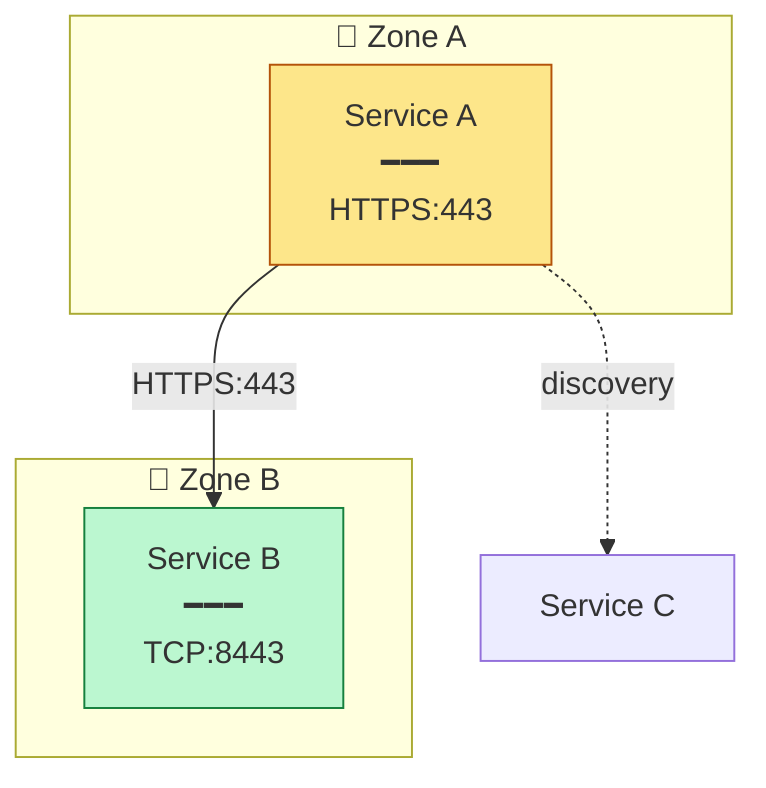

# Diagrams

Architecture, network, and integration diagrams, built as mermaid `.mmd` source and rendered to PNG. Keep the source checked in beside the image and regenerate it rather than editing the raster.

## Render pipeline

```
npx -y @mermaid-js/mermaid-cli@latest -i x.mmd -o x.png -b white
```

`-b white` matters: mermaid's default background is transparent, and a transparent PNG breaks as soon as it lands in a light-background deck or document. Always pass it. When the diagram needs to change, edit `x.mmd` and re-run the command; never touch the PNG directly.

## Diagram type by purpose

| Purpose | Type |
|---|---|
| Infrastructure topology, integration architecture | Top-to-bottom flowchart (`graph TB`) |
| A data model, especially to explain a source system's shape before a migration | Entity-relationship diagram (`erDiagram`) |
| A picture auto-layout genuinely can't express | A hand-laid tool like drawio |

Reach for drawio only after mermaid's auto-layout has actually failed the picture, not as a default. It costs manual layout maintenance mermaid doesn't.

## Styling conventions

- One `subgraph` per trust boundary or deployment zone, labelled with a short emoji plus name.
- Where colour carries meaning, set it with explicit `style` lines rather than mermaid's defaults: one colour for the human actor, one for a public or less-secure path, one for a secure path.
- Solid labelled arrows for a synchronous call, carrying protocol and port in the label (`HTTPS:443`).
- Dotted arrows (`-.->`) for a secondary or discovery-only relationship.
- Multi-line node labels: the node's name, a divider, then its port or protocol detail, joined with `<br/>`.

Illustrative shape, not a specific system:



## When a table beats a diagram

Enumerable requirements (source, target, port, protocol, direction, reason) belong in a markdown table. Reserve a flowchart for when the shape of the connectivity, which zone talks to which, is the point, not just the port list.

## When not to draw at all

If a reviewer asks for an updated diagram, check first whether the architecture actually changed. If the approved change adds no new data flow, the honest answer is that the existing diagram is confirmed unchanged. Reissue it rather than manufacturing a new-looking diagram just to appear responsive.

## Live dependency graphs

A dependency graph rendered live inside a product (React Flow plus dagre layout) is a different case from a static architecture diagram: the data driving it is free-text names a user typed, so resolution has to be tolerant of separators (comma, semicolon, newline, pipe, list) and matched loosely against known names. Draw anything unmatched as a dashed node rather than dropping it silently. The graph then doubles as a data-completeness report, not just a picture.
